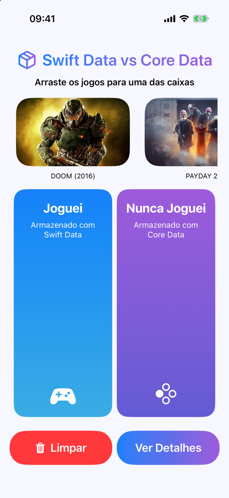
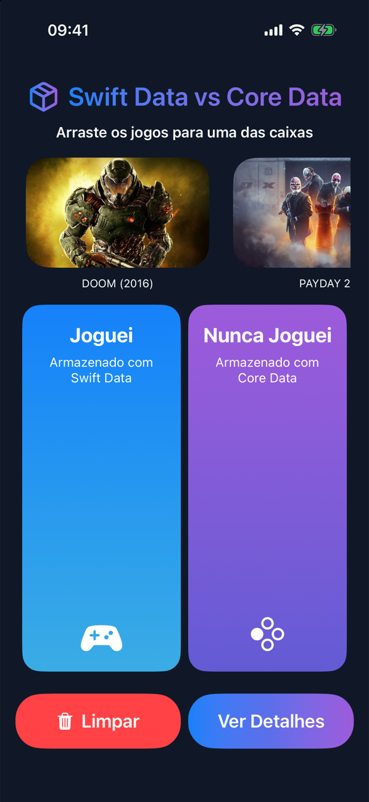
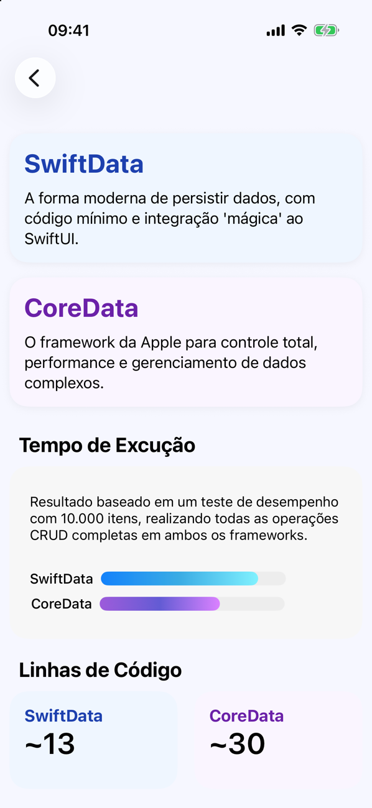

<div align="center">

# 🗃️ Swift Data vs Core Data

**Os dois frameworks de persistência da Apple, lado a lado, num app que você usa arrastando jogos.**

App iOS feito para explicar, na prática, a diferença entre **SwiftData** e **Core Data**.
Os jogos vêm de uma API pública e você os arrasta para duas caixas: uma salva com SwiftData,
a outra com Core Data. Fechou e abriu o app, os dois bancos continuam lá.


</div>

<table>
  <tr>
    <td width="33%"><br/><sub><b>Início</b>: arraste os jogos para uma das caixas</sub></td>
    <td width="33%"><br/><sub><b>Modo escuro</b></sub></td>
    <td width="33%"><br/><sub><b>Detalhes</b>: tempo de execução e linhas de código</sub></td>
  </tr>
</table>

> [!NOTE]
> Projeto em equipe da **Apple Developer Academy | UCB**. O desafio era estudar uma tecnologia
> e ensiná-la para a turma por meio de um app.

---

## ✨ O que ele faz

| | |
|---|---|
| 🎮 **Jogos de verdade** | A lista vem da [RAWG Video Games API](https://rawg.io/apidocs), com capa e nome |
| ✋ **Arrastar e soltar** | `.draggable` / `.dropDestination` com um modelo `Transferable`; dá para mover um jogo de uma caixa para a outra ou de volta para a lista |
| 🔵 **"Joguei" → SwiftData** | Classe `@Model`, `ModelContainer` e `ModelContext` |
| 🟣 **"Nunca joguei" → Core Data** | Modelo `.xcdatamodeld`, `NSPersistentContainer` e `NSManagedObjectContext` |
| 💾 **Persistência** | Os dois bancos sobrevivem ao fechar o app; o botão **Limpar** apaga ambos |
| 📚 **Guia de cada framework** | Como funciona, vantagens, quando usar e um passo a passo com prints de código (com zoom) |
| ⏱️ **Comparação** | Desempenho num teste de CRUD com 10.000 itens e quantas linhas cada um exige (~13 vs ~30) |

## 🔍 A mesma operação nos dois frameworks

**SwiftData**: o modelo é a própria classe Swift.

```swift
@Model
class ApiModelClass {
    var id: Int
    var name: String
    var backgroundImage: String
}

modelContext.insert(ApiModelClass(game))
try modelContext.save()
```

**Core Data**: entidade no editor visual e a pilha configurada à mão.

```swift
let container = NSPersistentContainer(name: "Games")
container.loadPersistentStores { _, error in /* ... */ }

let novoGame = GamesEntity(context: container.viewContext)
novoGame.name = game.name
try container.viewContext.save()
```

## 🧱 Estrutura

```
Challenge06/
├── data/
│   ├── SwiftData.swift             modelo @Model
│   ├── Games.xcdatamodeld          modelo do Core Data
│   ├── ModalContent.swift          textos do guia de cada framework
│   └── services/                   modelo da API e serviço do SwiftData
├── viewmodel/
│   ├── ApiViewModel.swift          busca na RAWG e filtra o que já foi salvo
│   ├── SwiftDataViewModel.swift
│   └── CoreDataController.swift    CRUD no Core Data
└── view/
    ├── screens/                    início, detalhes e modal do guia
    └── components/                 cards, caixas, barras de progresso, zoom
```

Arquitetura **MVVM**: as views só falam com os view models, e cada framework tem a sua camada.

## 🚀 Como rodar

1. Clone o repositório e abra `Challenge06.xcodeproj` no Xcode 16 ou mais novo.
2. Escolha um simulador ou iPhone com iOS 18.4+.
3. Rode com `⌘R`.

A chave da RAWG usada no projeto é pública e de estudo; para uso próprio, gere a sua em
[rawg.io/apidocs](https://rawg.io/apidocs) e troque em `ApiViewModel.swift`.

## 👥 Equipe

- [Daniel Leal Pimenta](https://github.com/daniellealpimenta): arquitetura, componentes de tela, integração com SwiftData e conteúdo do guia
- Israel Lacerda: modelo e configuração da API, caixas da tela inicial e ícone
- João Pedro Leonel: Core Data, tempo de execução e barras de progresso
- Kenay: conteúdo do modal
- Marcos Albuquerque: CRUD do Core Data e arrastar e soltar
